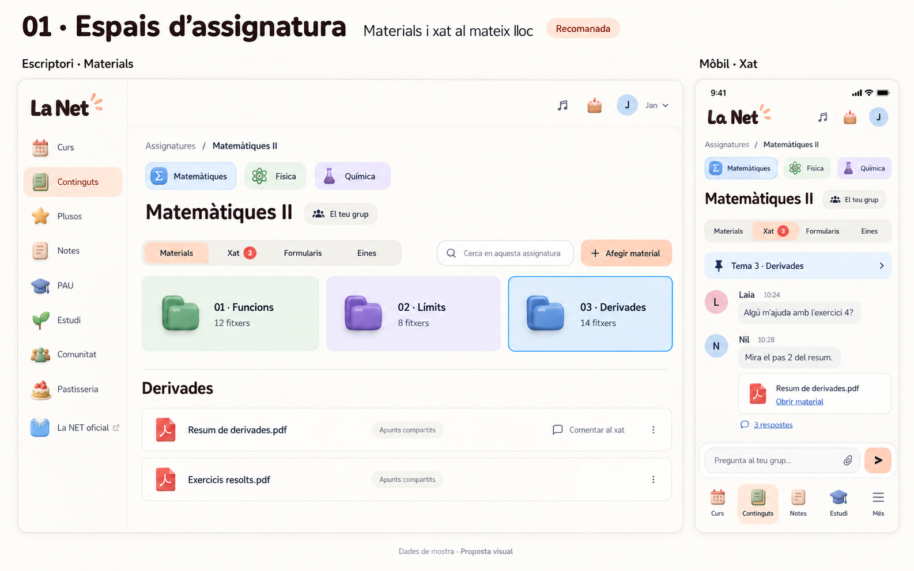
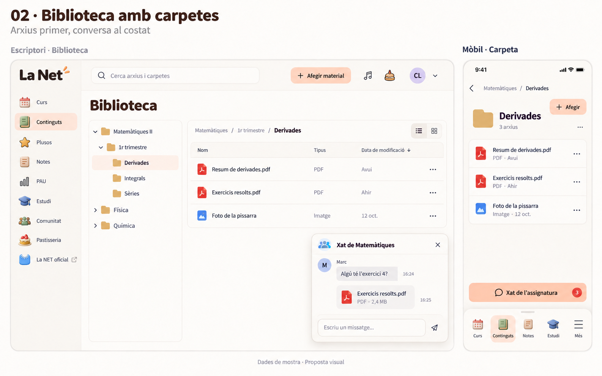
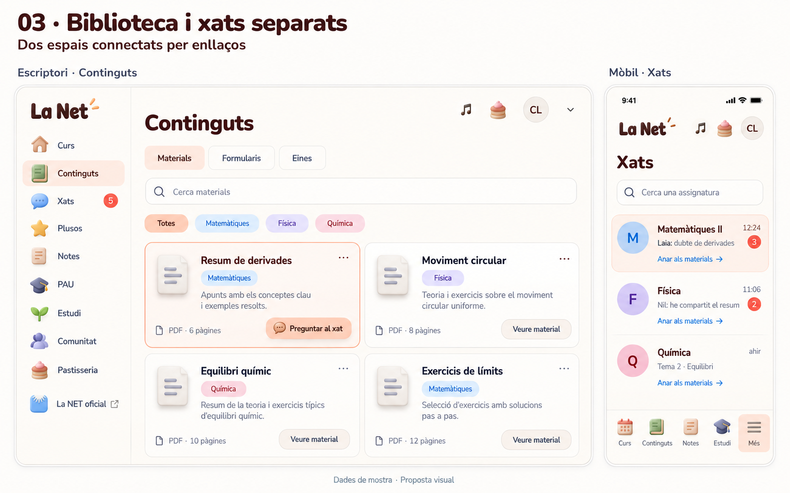
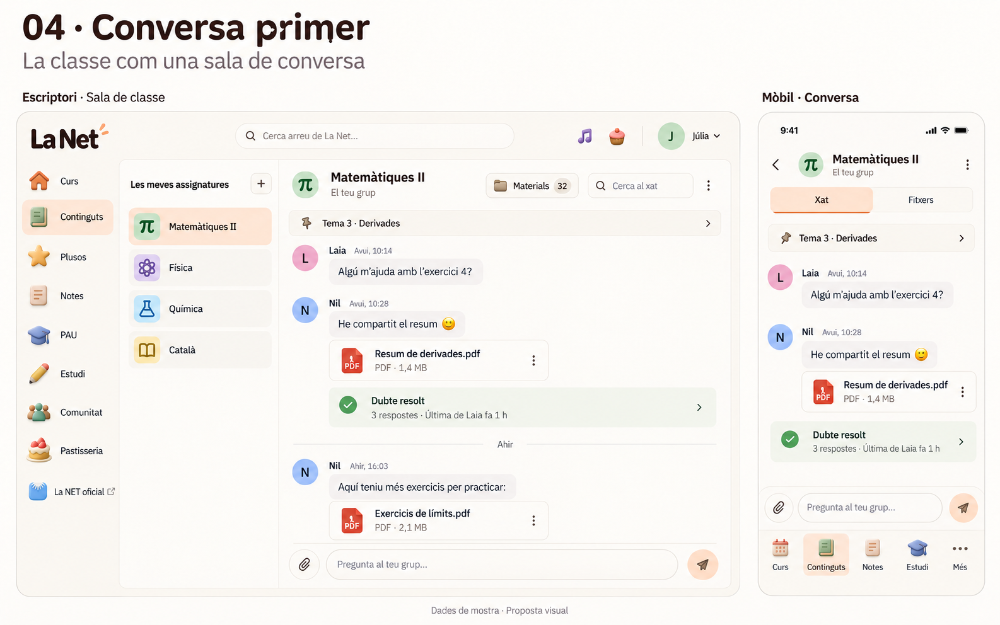

# Xats i continguts per assignatura · propostes UX

T76-01 · exploració de disseny. Quatre alternatives amb escriptori i mòbil, generades amb l’eina integrada imagegen i revisades. Les persones, els missatges, els fitxers i les dates són ficticis. Són mockups; aquesta proposta no implementa ni publica un servei de xat. La versió de producte continua sent 0.6.11.

## Punt de partida i criteri

Avui Continguts separa Materials, Formularis, Eines i Guia; les preferències, el filtre d’assignatura i els temes ja existeixen. El catàleg d’horaris distingeix assignatura, grup i variant de professorat. No hi ha un servei de xat acadèmic. La proposta ha de connectar aquests elements i conservar la revisió dels formularis, la privadesa de notes/perfil i els controls de fitxers.

Prioritats del rànquing, en aquest ordre: trobar un material conegut, preguntar sense perdre el context, claredat de pantalla, ús amb una mà al mòbil i manteniment quan creixin els continguts. És una valoració de disseny basada en aquests fluxos; no són puntuacions de conversió ni resultats d’un test amb estudiants.

La identificació visual d’assignatures i temes segueix el principi de [reconeixement en lloc de record](https://www.nngroup.com/articles/recognition-and-recall/). Separar la vista principal dels detalls opcionals segueix la [presentació progressiva de controls](https://www.nngroup.com/articles/progressive-disclosure/). L’ordre concret A–D és una inferència per a La Net, no una conclusió d’aquestes fonts.

## Rànquing

| Posició | Proposta | Quan destaca | Cost o límit |
| --- | --- | --- | --- |
| 1 · A | Espais d’assignatura | Un sol context per a materials, dubtes, formularis i eines. Temes a la vista i bon encaix al mòbil. | Cal fer una portada d’assignatures i preservar els enllaços i filtres actuals. |
| 2 · B | Biblioteca amb carpetes | Familiar per a qui busca arxius com a Drive; permet una col·lecció gran ben ordenada. | Assignatura → trimestre → tema és més profund. El xat flotant pot tapar materials i complica el mòbil. |
| 3 · C | Biblioteca i xats separats | Evolució gradual de Continguts i accés centralitzat a totes les converses. | Afegeix una destinació i exigeix més salts entre dubte i document; hi ha més notificacions per revisar. |
| 4 · D | Conversa primer | Dubtes ràpids, activitat de classe i resposta immediata. | Els apunts tendeixen a quedar enterrats a l’historial; el xat capta més atenció que l’estudi. |

## A · Espais d’assignatura · recomanada

Portada amb les assignatures inscrites, icona, nom i indicació discreta de novetats. Dins d’una assignatura: Materials, Xat, Formularis i Eines. La Guia del curs continua disponible com a recurs general, fora d’un xat concret.

L’estructura habitual és **assignatura → tema → material**. El trimestre és un filtre opcional, no un altre nivell obligatori de carpetes. Hi ha una ubicació clara «Sense tema» i una vista «Recents» per no obligar a classificar abans de compartir. «Desats» és una col·lecció personal, diferenciada de les carpetes compartides del curs.

L’escriptori del mockup mostra Materials; el mòbil mostra Xat dins de la mateixa assignatura. Són dos estats del mateix espai, no funcions exclusives de cada dispositiu. La conversa no ocupa un panell permanent mentre s’estudia. «Comentar al xat» obre un fil amb referència al material; «Obrir material» retorna al document i conserva el context.

## B · Biblioteca amb carpetes

Arbre de carpetes a l’escriptori i navegació per llistes al mòbil. El xat es pot obrir des de la carpeta i es tanca per tornar als fitxers. Té sentit si la prioritat és gestionar molts arxius; menys adequada com a primera experiència d’un estudiant que només vol els apunts d’avui.

## C · Biblioteca i xats separats

Manté Continguts per tipus i afegeix Xats com a destinació. Cada material enllaça al xat corresponent i cada sala als materials. Al mòbil s’hi arriba des de Més, conservant els cinc accessos habituals. És la via de menor reorganització inicial, però separa dues activitats que sovint formen part del mateix dubte.

## D · Conversa primer

La conversa és la pantalla principal de l’assignatura. Fitxers és una vista secundària. Útil per a grups molt actius i suport ràpid; caldria una bona biblioteca complementària perquè no es perdi el material entre missatges. No la recomano com a arquitectura principal d’una plataforma d’estudi.

## Com ha de funcionar el xat de l’opció A

- **Sala correcta automàticament:** assignatura i grup/variant d’inscripció. Compartir un nom d’assignatura no dona accés a converses d’altres grups. Cal conservar l’accés històric dels grups propis segons el canvi de curs, sense fusionar sales de professorat diferent.
- **Un fil per dubte:** resposta vinculada a la pregunta, assumpte curt i filtre «Dubtes oberts». L’autor pot marcar-lo resolt; això no el converteix en contingut oficial revisat.
- **Materials connectats:** PDFs, fotos i vídeos amb previsualització, títol, tipus i tema. Un document compartit en una conversa no entra automàticament a tota la biblioteca. «Afegir a Materials» és una acció explícita, amb autor i destinació.
- **Revisió diferenciada:** apunts d’alumnes i formularis revisats mantenen distintius i permisos diferents. Només el flux de revisió de delegats/admins pot validar un formulari.
- **Escriure sense pèrdues:** esborrany per sala; text capturat immediatament, adjunts pendents visibles, botó d’enviar desactivat si és buit. Estat «Enviant», «Enviat» o «Reintentar». Identificador de petició estable per no duplicar un enviament després d’una resposta perduda.
- **Lectura estable:** separador de no llegits i botó «Missatges nous». La vista no salta al final si l’usuari llegeix missatges antics. En tornar d’un PDF, es recuperen la posició i el fil.
- **Atenció:** silenciar per assignatura; mencions opcionals i comptador discret. Sense indicadors públics de presència ni pressió de confirmacions de lectura. Respectar el mode d’estudi i les preferències de notificació.
- **Mòbil:** una vista principal cada vegada. Fils i fitxers s’obren en una pantalla o full accessible; composer per damunt del teclat, retorn clar i àrees tàctils suficients. La barra global conserva Curs, Continguts, Notes, Estudi i Més.
- **Accessibilitat:** noms visibles acompanyant icones, informació de no llegits que no depèn del color, teclat i focus correctes, contrast verificat, moviments reduïts i estat d’enviament anunciat sense llegir automàticament tot l’historial.
- **Seguretat:** autorització per sala al servidor, paginació limitada, límits per usuari/sala i protecció antiabús compartida. Text tractat com a dades, fitxers pel procés segur existent, accions de denunciar i moderació amb autoria. Les notes privades no es comparteixen automàticament.

## Pla per desenvolupar A

1. **Espais d’assignatura i temes.** Reutilitzar catàleg, inscripcions i preferències. Donar una ubicació als continguts existents per metadades, mantenint IDs, autors, URLs i fitxers originals. Cerca, Recents i Desats funcionen també entre assignatures.
2. **Xat amb text i fils.** Model privat per sala, missatges, respostes i lectura. Proves d’autorització entre usuaris/grups, ordre, paginació, enviament duplicat, esborranys i reconnexió abans de passar a adjunts.
3. **Adjunts i biblioteca.** Referències a materials existents i pujada segura nova. Revisió de permisos i cicle de vida: retirar un missatge no ha d’esborrar un document que encara s’utilitza en altres materials. La reorganització de carpetes no duplica fitxers a R2.
4. **Validació amb estudiants i publicació.** Fixture local a 320/390/820/1440, Chromium/Firefox/WebKit i teclat mòbil. Assaig amb una mostra petita d’estudiants: trobar un resum, preguntar sobre un PDF, recuperar un dubte resolt, tornar al material i silenciar una sala. Mesurar èxit i errors abans de considerar validat el rànquing. Revisar còpia privada i migracions necessàries separadament, PR/CI i publicació amb versió pròpia.

Els mockups representen jerarquia i flux, no una especificació exacta dels píxels, les icones ni tots els estats. La implementació ha de reutilitzar els assets 3D i components accessibles existents de La Net. Cap fitxer real d’estudiant, fotografia de perfil o credencial s’ha utilitzat en les propostes.
